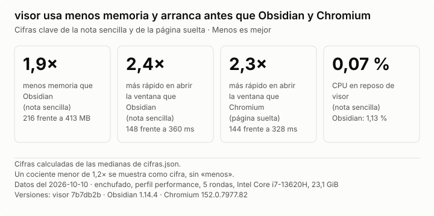
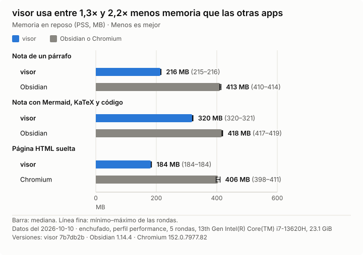
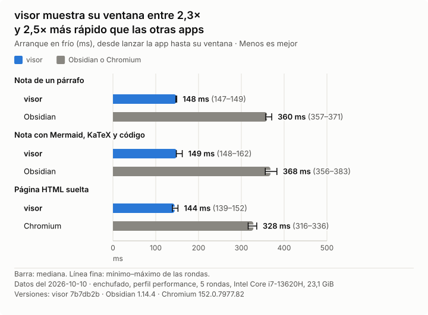
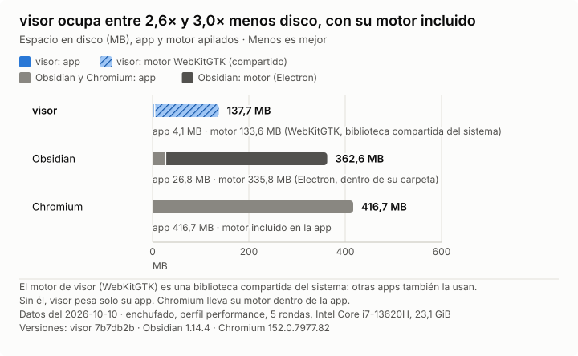

<h1 align="center">
  <picture>
    <source media="(prefers-color-scheme: dark)" srcset="docs/img/logo/logotipo-oscuro.svg">
    
  </picture>
</h1>

[English](README.md)

visor es una aplicación para estudiar con inteligencia artificial (IA), al estilo de Obsidian. Muestra una **bóveda**: una carpeta con páginas HTML y notas Markdown. También abre un archivo HTML suelto, sin bóveda. Tú lees, subrayas y comentas. Tu agente de IA controla visor por la terminal o por MCP, lee tus anotaciones y te responde en la misma página.

visor está hecho en Rust con tao, wry y WebKitGTK. Funciona solo en Linux con Wayland.


## Rendimiento

Con una nota o página sencilla, visor usa más o menos la mitad de memoria que Obsidian o Chromium; con una nota pesada (Mermaid, KaTeX, código), alrededor de una cuarta parte menos que Obsidian. Abre su ventana en menos de la mitad de tiempo.



<details>
<summary>Gráficas de memoria, arranque y espacio en disco</summary>







</details>

Cómo se midió: la misma bóveda en el mismo portátil, 5 rondas alternadas, cada app con su configuración por defecto, sin extensiones y con el perfil ya creado por un primer arranque que no cuenta. La memoria es el PSS de todo el árbol de procesos, 10 segundos después de aparecer la ventana. El arranque es el tiempo desde que se lanza la app hasta que aparece su ventana; no incluye dibujar la página. El espacio en disco cuenta el motor web de cada app; el de visor (WebKitGTK) es una biblioteca del sistema que comparten otras apps. El script es `tools/medir/comparar.py` y los datos están en `docs/img/cifras.json`.

## Qué necesitas

- Linux en x86_64 con Wayland, GTK 3 y WebKitGTK 4.1 (versión 2.38 o posterior).
- glibc 2.39 o posterior para el programa ya compilado: Arch, Fedora 40, Ubuntu 24.04, Debian 13 o más recientes. En sistemas más antiguos, compílalo tú.
- Un agente de IA que sepa usar herramientas, como Claude Code.
- Para ver vídeo de la web, estos paquetes de tu distribución: `gst-libav` y `gst-plugins-bad`. También conviene instalar `gst-plugin-va` (usa la tarjeta gráfica) y `gst-plugin-dav1d` ([por qué](docs/adr/0032-requisitos-de-gstreamer.md)).

## Instalar

Escribe estas órdenes en una terminal:

```
curl -LO https://github.com/ruben-salas20/visor/releases/latest/download/visor-x86_64-linux
install -m 755 visor-x86_64-linux ~/.local/bin/visor
```

`~/.local/bin` tiene que ser una carpeta donde tu sistema busque programas. Para comprobar la descarga, compara lo que muestra `sha256sum visor-x86_64-linux` con el `sha256` que aparece junto al archivo en la [página de la versión](https://github.com/ruben-salas20/visor/releases/latest).

Desde ese momento visor se actualiza solo: al arrancar, como mucho una vez al día, busca una versión nueva en GitHub Releases, la comprueba y la instala para el siguiente arranque. Lo puedes desactivar en Ajustes (Ctrl+,).

Al arrancar, visor escribe también el archivo `~/.local/share/applications/visor.desktop`. Es una *entrada de aplicación*: una descripción corta que hace que el gestor de archivos ofrezca visor al abrir un `.md` o un `.html` (por ejemplo, en «Abrir con»). Para que sea el predeterminado para esos archivos, elígelo en los ajustes de aplicaciones predeterminadas de tu escritorio. Los archivos fuera de tus bóvedas se abren como archivos sueltos; mira `visor help`.

### Compilarlo tú

Necesitas Rust 1.89 o posterior. Escribe estas órdenes dentro de la carpeta de visor:

1. Compila el programa:

   ```
   cargo build --release
   ```

2. Copia el archivo `target/release/visor` a `~/.local/bin` o a otra carpeta donde tu sistema busque programas.

El binario dentro de `target/` nunca se actualiza.

El paquete de CodeMirror ya está en `assets/`. Solo hace falta regenerarlo con `npm ci && npm run build` en `tools/codemirror/`.

## Abrir una bóveda

- Desde la aplicación: escribe `visor` en la terminal y pulsa Ctrl+O para elegir una carpeta.
- Desde la terminal: `visor open <carpeta>`, con la ruta de tu carpeta en lugar de `<carpeta>`.

Para ver un solo archivo HTML sin crear una bóveda, usa `visor open <archivo.html>`. Ese archivo no admite anotaciones.

visor recuerda las pestañas de cada bóveda y la reabre como la dejaste. Si un archivo cambia en el disco, la página se actualiza sola.

## Atajos principales

| Atajo | Acción |
|---|---|
| Ctrl+O | Abrir una carpeta |
| Ctrl+B | Mostrar u ocultar el panel (el árbol de la bóveda) |
| Ctrl+T, Ctrl+W | Abrir o cerrar una pestaña |
| Ctrl+\| o Ctrl+\ | Dividir la ventana en dos lados, o volver a uno |
| Ctrl+E | Editar la nota abierta, o volver a leerla |
| Ctrl+N | Crear una nota nueva |
| Ctrl+Shift+A | Anotar un elemento o un punto de la página |
| Ctrl+Shift+L | Ver la lista de anotaciones de la página |
| Ctrl+L | Escribir una dirección web o una ruta |
| Ctrl+, | Ajustes: tema, tamaño del texto y actualizaciones |

`visor help` lista todos los atajos.

## Anotar y recibir respuestas

1. Selecciona un texto de una página de la bóveda. Elige un color para resaltarlo, o pulsa «Comentar» para escribir tu comentario.
2. Para anotar un gráfico o una imagen, pulsa Ctrl+Shift+A y haz clic en el elemento.
3. Tu agente lee la anotación y responde. Ves la respuesta al momento en tu nota y puedes contestar.

visor guarda las anotaciones en `<bóveda>/.visor/anotaciones/`. No modifican tus páginas. Si el texto anotado cambia de sitio en la página, la anotación lo sigue. Si el texto cambia o desaparece, la anotación queda huérfana y la ves en la lista de anotaciones.

## Conectar tu agente

Tu agente controla visor con órdenes de terminal o por MCP, un protocolo para que los agentes usen programas externos.

```
visor                              # abre la aplicación
visor open <carpeta|archivo|URL> [--tab | --beside]
visor help                         # todas las órdenes y cómo escribir páginas
visor mcp                          # servidor MCP por la entrada y salida estándar
```

Para registrar visor en Claude Code, escribe:

```
claude mcp add visor -- visor mcp
```

Después pide a tu agente que use la herramienta `guide`. Esa herramienta devuelve el mismo texto que `visor help`: qué puede hacer el agente con visor y cómo escribir páginas para visor.

## Problemas frecuentes

- **Un vídeo de la web no se reproduce.** Instala los paquetes `gst-libav` y `gst-plugins-bad` que indica la sección «Qué necesitas».
- **Una página pierde sus datos guardados.** visor usa siempre la misma conexión interna de tu equipo (el puerto). Si otro programa la ocupa, visor elige otra y las páginas empiezan sin sus datos esa sesión. Cierra el otro programa y reinicia visor.

## Organización del repositorio

- `src/ui/`: ventana, pestañas y panel (GTK).
- `src/vault.rs`, `src/vault/`: acceso a la bóveda, anotaciones, Markdown y configuración.
- `src/agent/`: terminal, servidor del socket y MCP. `help.txt` es el texto de `visor help`.
- `src/page/`: JavaScript y CSS que se ejecutan dentro de las páginas.
- `assets/`, `build.rs`: bibliotecas incluidas (KaTeX, highlight.js, Mermaid, CodeMirror), comprimidas con brotli al compilar.
- `tools/`: generador del paquete de CodeMirror, scripts de medidas (`tools/medir/`) y los que hacen el GIF del README (`tools/video/`).

## Más documentación

El resto de la documentación está en español.

- [CONTRIBUTING.md](CONTRIBUTING.md): cómo contribuir, en inglés. Se aceptan aportes en español.
- [README.md](README.md): este README en inglés.
- [CONTEXT.md](CONTEXT.md): glosario de términos.
- [AGENTS.md](AGENTS.md): guía para agentes que programan en este repositorio.
- [docs/adr/](docs/adr/): decisiones de diseño y sus mediciones.
- [docs/pruebas.md](docs/pruebas.md): cómo probar y medir.

## Licencia

MIT. Consulta [LICENSE](LICENSE).
