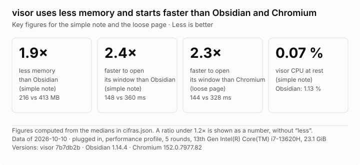
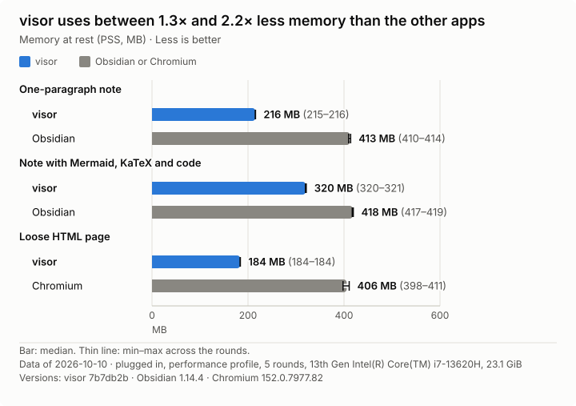
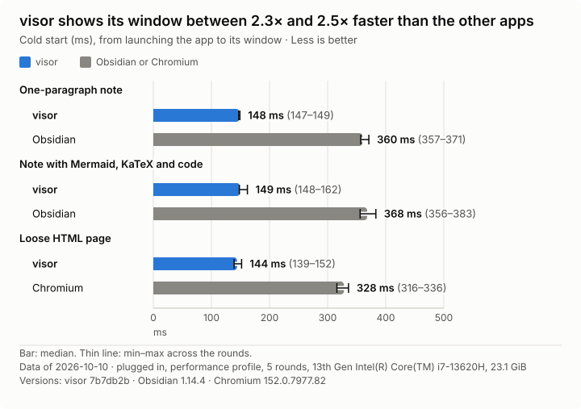
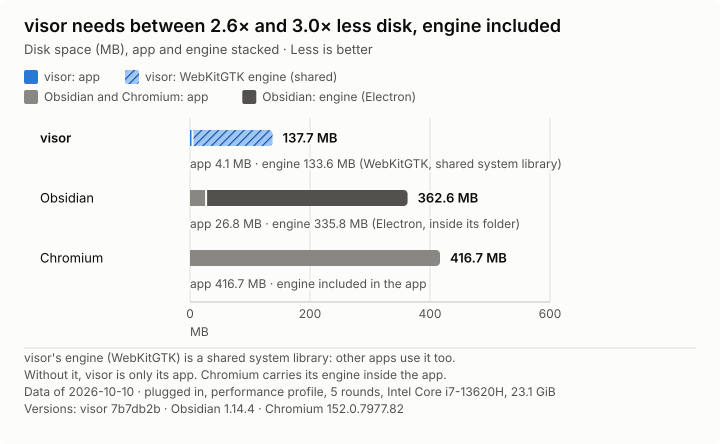

<h1 align="center">
  <picture>
    <source media="(prefers-color-scheme: dark)" srcset="docs/img/logo/logotipo-oscuro.svg">
    
  </picture>
</h1>

[Español](README.es.md)

visor is an app for studying with artificial intelligence (AI), in the spirit of Obsidian. It shows a **vault**: a folder of HTML pages and Markdown notes. It also opens a single loose HTML file, without a vault. You read, highlight and comment. Your AI agent drives visor from the terminal or through MCP, reads your annotations and replies on the same page.

visor is built in Rust with tao, wry and WebKitGTK. It runs only on Linux with Wayland.


## Performance

With a simple note or page, visor uses about half the memory of Obsidian or Chromium; with a heavy note (Mermaid, KaTeX, code), about a quarter less than Obsidian. Its window opens more than twice as fast.



<details>
<summary>Memory, startup and disk space charts</summary>







</details>

How it was measured: the same vault on the same laptop, 5 alternating rounds, each app with its default settings, no extensions and a profile warmed up by a first, uncounted launch. Memory is the PSS of the whole process tree, 10 seconds after the window appears. Startup is the time from launching the app until its window appears; it does not include drawing the page. Disk space counts each app's web engine; visor's (WebKitGTK) is a system library that other apps share. The script is `tools/medir/comparar.py` and the data are in `docs/img/cifras.json`.

## What you need

- Linux on x86_64 with Wayland, GTK 3 and WebKitGTK 4.1 (version 2.38 or later).
- glibc 2.39 or later for the ready-made program: Arch, Fedora 40, Ubuntu 24.04, Debian 13 or newer. On older systems, build it yourself.
- An AI agent that can use tools, such as Claude Code.
- To play web video, these packages from your distribution: `gst-libav` and `gst-plugins-bad`. Also install `gst-plugin-va` (uses the graphics card) and `gst-plugin-dav1d` ([why](docs/adr/0032-requisitos-de-gstreamer.md)).

## Install

Type these commands in a terminal:

```
curl -LO https://github.com/ruben-salas20/visor/releases/latest/download/visor-x86_64-linux
install -m 755 visor-x86_64-linux ~/.local/bin/visor
```

`~/.local/bin` must be a folder where your system looks for programs. To check the download, compare the output of `sha256sum visor-x86_64-linux` with the `sha256` shown next to the file on the [releases page](https://github.com/ruben-salas20/visor/releases/latest).

From then on visor updates itself: when it starts, at most once a day, it looks for a new version on GitHub Releases, checks it and installs it for the next start. You can turn this off in Settings (Ctrl+,).

### Build it yourself

You need Rust 1.89 or later. Type these commands inside the visor folder:

1. Build the program:

   ```
   cargo build --release
   ```

2. Copy the file `target/release/visor` to `~/.local/bin` or another folder where your system looks for programs.

The binary inside `target/` is never updated.

The CodeMirror bundle is already in `assets/`. Regenerate it only when needed, with `npm ci && npm run build` in `tools/codemirror/`.

## Open a vault

- From the app: type `visor` in the terminal and press Ctrl+O to choose a folder.
- From the terminal: `visor open <folder>`, with the path to your folder instead of `<folder>`.

To view a single HTML file without creating a vault, use `visor open <file.html>`. That file does not take annotations.

visor remembers the tabs of each vault and reopens it as you left it. If a file changes on disk, the page updates by itself.

## Main shortcuts

| Shortcut | Action |
|---|---|
| Ctrl+O | Open a folder |
| Ctrl+B | Show or hide the panel (the vault tree) |
| Ctrl+T, Ctrl+W | Open or close a tab |
| Ctrl+\| or Ctrl+\ | Split the window into two sides, or go back to one |
| Ctrl+E | Edit the open note, or go back to reading it |
| Ctrl+N | Create a new note |
| Ctrl+Shift+A | Annotate an element or a point on the page |
| Ctrl+Shift+L | See the list of annotations on the page |
| Ctrl+L | Type a web address or a path |
| Ctrl+, | Settings: theme, text size and updates |

`visor help` lists every shortcut.

## Annotate and get replies

1. Select text on a vault page. Choose a color to highlight it, or press «Comentar» to write a comment.
2. To annotate a chart or an image, press Ctrl+Shift+A and click the element.
3. Your agent reads the annotation and replies. You see the reply right away in your note and can answer it.

visor saves annotations in `<vault>/.visor/anotaciones/`. They do not change your pages. If the annotated text moves on the page, the annotation follows it. If the text changes or disappears, the annotation becomes orphaned and you see it in the list of annotations.

## Connect your agent

Your agent controls visor with terminal commands or through MCP, a protocol that lets agents use external programs.

```
visor                              # open the app
visor open <folder|file|URL> [--tab | --beside]
visor help                         # every command and how to write pages
visor mcp                          # MCP server over standard input and output
```

To register visor in Claude Code, type:

```
claude mcp add visor -- visor mcp
```

Then ask your agent to use the `guide` tool. That tool returns the same text as `visor help`: what the agent can do with visor and how to write pages for visor.

## Common problems

- **A web video does not play.** Install the `gst-libav` and `gst-plugins-bad` packages listed under «What you need».
- **A page loses its saved data.** visor always uses the same internal connection on your computer (the port). If another program takes it, visor picks another one and pages start without their data for that session. Close the other program and restart visor.

## Repository layout

- `src/ui/`: window, tabs and panel (GTK).
- `src/vault.rs`, `src/vault/`: vault access, annotations, Markdown and configuration.
- `src/agent/`: terminal, socket server and MCP. `help.txt` is the text of `visor help`.
- `src/page/`: JavaScript and CSS that run inside pages.
- `assets/`, `build.rs`: bundled libraries (KaTeX, highlight.js, Mermaid, CodeMirror), compressed with brotli at build time.
- `tools/`: CodeMirror bundle generator, benchmark scripts (`tools/medir/`) and the scripts that make the README GIF (`tools/video/`).

## More documentation

The rest of the documentation is in Spanish.

- [README.es.md](README.es.md): this README in Spanish.
- [CONTEXT.md](CONTEXT.md): glossary.
- [AGENTS.md](AGENTS.md): guide for agents working on this repository.
- [docs/adr/](docs/adr/): design decisions and their measurements.
- [docs/pruebas.md](docs/pruebas.md): how to test and measure.

## License

MIT. See [LICENSE](LICENSE).
