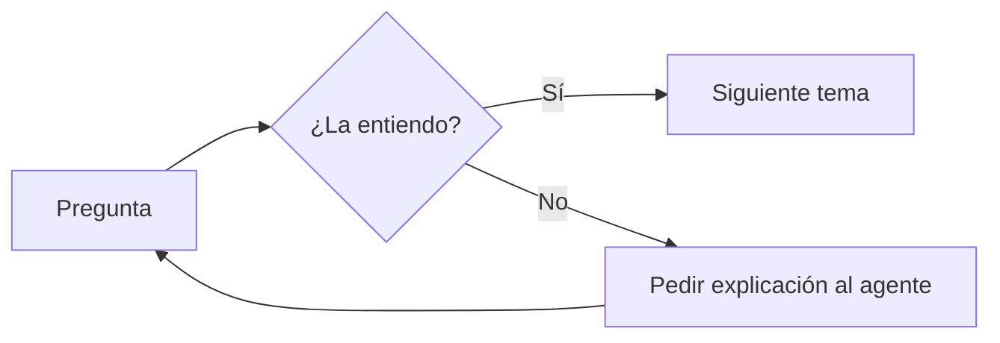
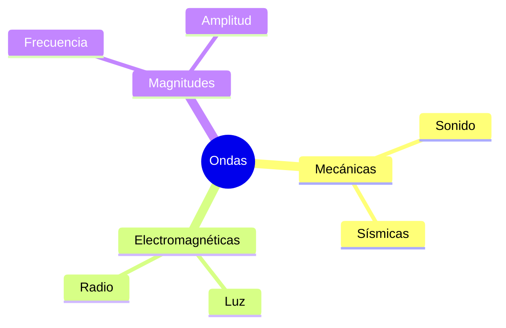
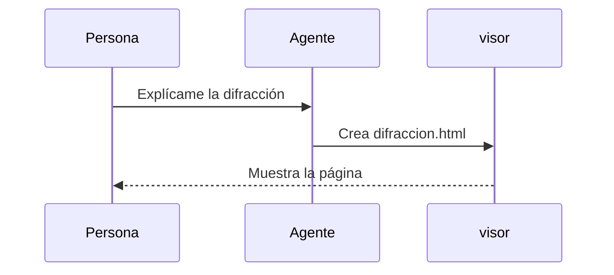

# Diagramas

Cambia entre un tema claro y uno oscuro de Omarchy y comprueba que estos diagramas y fórmulas se leen bien en los dos.

## Diagrama de flujo



## Mapa mental



## Secuencia



## Fórmulas

La energía de un fotón es $E = h f$, y la relación de dispersión:

$$
\omega^2 = c^2 k^2 + \frac{m^2 c^4}{\hbar^2}
$$

## Código

```rust
fn frecuencia(periodo: f64) -> f64 {
    1.0 / periodo
}
```
