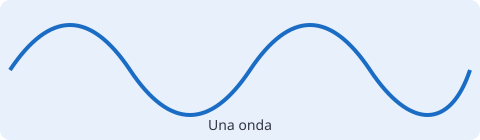
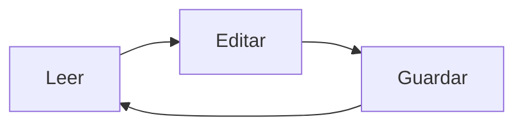

# Vista previa en vivo

Pulsa **Ctrl+E**. Fuera de la línea del cursor no se ven las marcas de Markdown; al entrar en una línea, vuelven a aparecer.

## Texto

Un párrafo con **negrita**, *cursiva*, ~~tachado~~, `código en línea` y una fórmula en línea: $E = mc^2$. Un precio como 5 $ no es una fórmula.

> Una cita con **negrita** dentro.
> Segunda línea de la cita.

- Primer punto
- Segundo punto con [un enlace a la web](https://example.com "Ejemplo")
  - Un punto anidado
1. Primero
2. Segundo

---

## Enlaces entre notas

- [[tareas]]: enlace a una nota que existe.
- [[edicion|La nota larga]]: con otro texto.
- [[edicion#Sección 10]]: a una sección.
- [[Nota que no existe todavía]]: se ve gris y discontinua; Ctrl+clic la crea.

## Casillas

- [ ] Pendiente
- [x] Hecha
- [x] Otra pendiente

## Código

```rust
fn main() {
    let saludo = "hola";
    println!("{saludo}, mundo"); // comentario
}
```

```python
def doble(x: int) -> int:
    return 2 * x  # devuelve el doble
```

## Tabla

| Magnitud | Símbolo | Unidad |
|:---------|:-------:|-------:|
| Longitud de onda | $\lambda$ | m |
| Frecuencia | *f* | Hz |
| Velocidad | **v** | m/s |

## Fórmula en bloque

$$
v = \lambda f
$$

## Imagen



## Diagrama



Fin de la nota.

Notá nuevá
Nota neuva