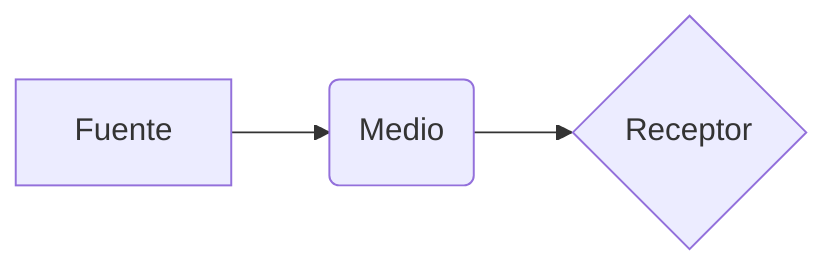

# Ondas

Una onda transporta **energía** sin transportar materia. Ver también [[diagramas#Mapa mental]], [[edicion]] y [[Nota que no existe]].

## Fórmulas

La velocidad es $v = \lambda f$. La ecuación de onda:

$$
\frac{\partial^2 y}{\partial t^2} = v^2 \frac{\partial^2 y}{\partial x^2}
$$

## Código

```python
def frecuencia(periodo: float) -> float:
    """Inversa del periodo."""
    return 1 / periodo  # en hercios
```

## Diagrama



> [!NOTE]
> Las ondas sonoras necesitan un medio.

| Magnitud | Símbolo | Unidad |
|---|---|---|
| Frecuencia | f | Hz |
| Longitud de onda | λ | m |

- [x] Leer el tema
- [x] Hacer ejercicios
