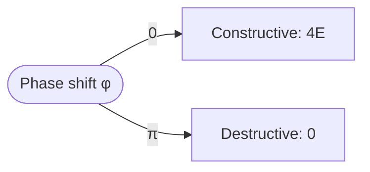

# Energy of two waves

Energy goes with the **square** of the amplitude: $E \propto A^2$.

$$
A^2 = A_1^2 + A_2^2 + 2A_1A_2\cos\varphi
$$



```python
from math import cos

def energy(a1, a2, phase):
    return a1**2 + a2**2 + 2*a1*a2*cos(phase)
```
