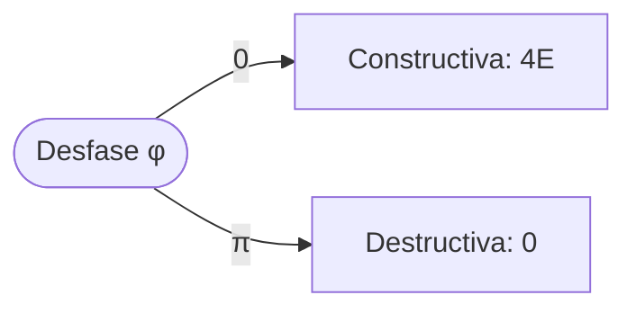

# Energía de dos ondas

La energía va con el **cuadrado** de la amplitud: $E \propto A^2$.

$$
A^2 = A_1^2 + A_2^2 + 2A_1A_2\cos\varphi
$$



```python
from math import cos

def energia(a1, a2, fase):
    return a1**2 + a2**2 + 2*a1*a2*cos(fase)
```
